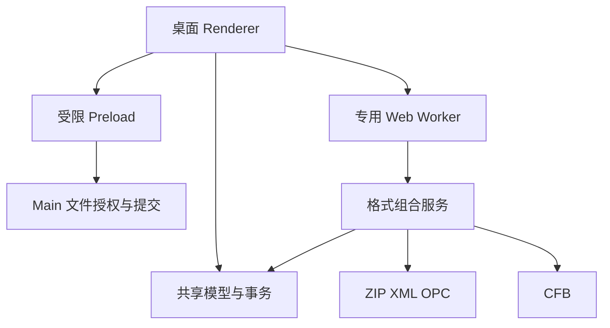

# M1：桌面与兼容性基础设施

更新日期：2026-11-24。开发版本：`0.1.0-dev.1`。本文说明已经进入仓库的 M1 实现及其验收入口；完整规范仍见 [`specs/`](specs/README.md)。

**当前代码已经覆盖 M1.1–M1.10 的实施范围，整批集成与各原生平台验收仍须对应真实运行结果。** 本文不会把容器读写、内部草稿或一个平台的结果换算成完整 Office 兼容性。没有创建正式 Release 或安装包。

## 用户当前能够做什么

桌面工作台提供首页、最近文件、多标签、中文／英文、浅色／深色／系统主题和文件／撤销菜单。新建文字、表格或演示草稿后，可以验证共用会话、撤销／重做、标题修改、本地保存／另存、脏文档关闭提示及恢复。

三个草稿界面是明确标注范围的基础设施预览：文字面板编辑一个文本 run；表格面板演示 A1:C3 的稀疏 typed-cell 事务；演示面板添加矩形并检验坐标与命中。它们为后续真正的编辑器提供模型、历史和文件通路。

打开受支持的 Office 文件时，当前显示实际容器、识别格式／版本标记、部件或流、长度、SHA-256 和诊断。源文件处于**只读结构检查**模式，允许将完整原字节保存为另一个文件。正文、工作表和幻灯片尚未语义导入；不能编辑后保存回 Office 格式。

内部草稿使用 `.oex`。它是 Office EX 的版本化模型包络，供 M1 保存／恢复流程使用，不能被 Microsoft Office 直接打开。保存检查要求正确扩展名；不会用重命名方式输出伪 Office 文件。

## M1.1–M1.10 实施与证据映射

下表的“实现”表示存在对应执行代码。“验证入口”是可复现的测试或构建命令，不等同于该条规范已经覆盖全部场景。实际结果需要与提交、工具版本、平台及输出关联。

| 子阶段 | 已实现范围 | 主要位置 | 验证入口／后续边界 |
|---|---|---|---|
| M1.1 工程与契约 | 12 个 workspace；严格 TS；固定直接依赖／单 lock；公开入口、依赖方向、无环和纯领域检查 | 根 package/tsconfig、`contracts`、架构脚本 | `typecheck`、`check:architecture`、依赖审查；后续新增模块必须更新依赖规则 |
| M1.2 核心模型 | Writer/Sheets/Slides v1 模型；ID、EMU、Unicode、资源摘要、样式和外部数据验证 | `core/model.ts`、`core/resources.ts` | `tests/core.test.ts`；领域完整编辑能力仍按 M2–M4 实现 |
| M1.3 事务与历史 | expectedRevision、原子批量命令、增量逆操作、历史预算、dirty、保存票据、过期派生任务 | `core/session.ts`、领域命令构建器 | `tests/core.test.ts`：失败无副作用、隔离、undo/redo、保存竞态 |
| M1.4 现代容器 | 有界 ZIP 读写；CRC/路径/重复/资源检查；XML 安全解析；OPC 关系和类型；原部件保留 | `ooxml/src/{zip,xml,opc,limits}.ts` | `tests/ooxml.test.ts`、`test:interop`；不含完整 DOCX/XLSX/PPTX 领域映射 |
| M1.5 旧版容器 | 原创 CFB v3/v4 读写；FAT/DIFAT/MiniFAT、目录/storage/stream、元数据、循环／交叉链／越界检查 | `cfb/src/index.ts` | `tests/cfb.test.ts`、`tests/cfb_interop.py`；DOC/XLS/PPT 语义层仍是 M2-L/M3-L/M4-L |
| M1.6 格式服务 | 签名与内容识别、有限版本标记检查、加密／宏／签名／外链诊断、能力报告、保存计划、OEX 编解码 | `format-common`、`format-service` | `tests/format-service.test.ts`；C1 容器检查与 C0 Office 语义能力分开报告 |
| M1.7 文件与恢复 | 作用域 token、外部改动检查、同目录临时文件、重读／同步／原子提交、替换前备份、恢复快照／配额／hash | `apps/desktop/src/{file-service,recovery}.ts` | 文件／恢复故障测试与原生 smoke；保留平台 TOCTOU、网络文件系统和 durability 边界 |
| M1.8 桌面与 UI | Electron 安全配置、本地协议／CSP、受限 preload/IPC、多标签、菜单／设置／主题／语言／关闭流程 | `apps/desktop`、`ui` | IPC 策略测试、`smoke:desktop`；原生执行结果待对应平台证据确认 |
| M1.9 渲染基础 | EMU 变换、设备缩放、旋转、逆变换命中、字体接口／缓存／诊断、Canvas 适配 | `render`、`ui/src/font-metrics.ts` | `tests/render.test.ts`；Canvas 字簇位置标为 estimated，未宣称排版精度 |
| M1.10 集成验收 | 构建、独立容器互读、架构／许可证检查、真实 Electron smoke、多平台 CI、交接文档 | `scripts/`、`tests/`、`.github/workflows/m1.yml` | 每个平台须有真实成功结果；工作流／测试脚本本身不算通过证据 |

## 模块和执行边界

| 层 | 职责 | 关键约束 |
|---|---|---|
| `contracts` | ID、单位、错误、诊断和取消契约 | 不依赖其他包 |
| `core` | 权威模型、校验、会话、历史、资源、样式 | 无 DOM、Node、Electron、文件或网络依赖 |
| `writer/sheets/slides` | 三领域的公开类型与命令构建器 | 共用核心；不会按文件扩展名复制编辑器 |
| `render` | 坐标、几何、命中和注入式字体测量 | 平台无关；Canvas 实现在 UI 层 |
| `format-common` | 有界读取、能力／诊断、适配接口和保存计划 | 不反向导入具体容器 |
| `ooxml/cfb` | 现代与旧版基础容器 | 原创策略和语义；不访问宿主文件系统 |
| `format-service` | 组合检测和内部草稿编解码 | 只在专用 sandbox worker 运行实际解析 |
| `ui` | 视图、事务调用、任务管理和本地交互 | 不直接操作文件或拼接 Office 语义 |
| `apps/desktop` | 原生窗口、授权文件字节、保存、恢复、设置 | 不解析不可信 Office 文档 |



解析任务单独创建 worker；完成、取消或 15 秒超时后终止，最多同时 4 个 worker。关闭标签取消该文档的工作，派生结果检查任务／revision。默认网络访问、外部导航、弹窗、权限申请和文档脚本均被拒绝。sandbox、context isolation、web security 开启，renderer 和 worker 的 Node integration 关闭。

这些边界的具体取舍和新增模块说明见 [ADR 0001](decisions/0001-m1-boundaries.md)。

## 公共 API 的使用约定

跨包只能通过 `@office-ex/<包名>` 的 `src/index.ts` 公共出口导入。公开错误使用 `OfficeError`，错误码为 `invalid/unsupported/unsafe/limit/conflict/cancelled/io/internal`；跨 IPC/worker 转换为可序列化 `Result`。诊断共享 `code/severity/featureId/sourceLocation/messageKey/safeAction`。

### 模型与命令

`createDocument(kind, documentId, title?)` 创建格式无关模型；`validateDocument(unknown)` 是导入／恢复的边界。验证拒绝非法 schema、重复稳定 ID、坏引用、样式继承环、危险对象键、getter、非 JSON 数据和超预算结构。快照冻结，调用者不能直接修改会话权威内容。

```ts
import { createDocument, DocumentSession } from '@office-ex/core';
import { replaceText } from '@office-ex/writer';

const session = new DocumentSession(createDocument('writer', 'example-1', '示例'));
session.execute(replaceText(session.snapshot(), 'run-1', 0, 0, '中文 😀'));
session.undo();
session.redo();

const ticket = session.beginSave();
// 调用方使用 ticket.document 完成序列化、验证和持久文件提交。
// 仅在持久提交成功后调用 completeSave(ticket)；失败则 cancelSave(ticket)。
```

每条命令包含 documentId、expectedRevision、type、payload，先完成权限、范围和模型验证再提交。失败不修改模型、历史或 dirty。历史保存正反增量，默认最多 200 项／64 MiB；新编辑清理 redo，撤销／重做仍递增 revision。

dirty 对比持久内容身份与最后成功保存的内容身份。保存票据保留当时快照；保存期间的新编辑不会因旧快照保存成功而被标记为已保存。派生布局／计算缓存不进入文档源模型。

### 容器与格式

| API | 用途 |
|---|---|
| `readZip/writeZip` | 原始 ZIP 部件读写，检查声明与实际数据预算、路径和完整性 |
| `parseXml/serializeXml` | 安全 XML 边界；禁止 DTD、外部／自定义实体、XInclude 等 |
| `openOpc/writeOpc` | OPC 类型／关系图和原始部件保护；无更改时保留原包字节 |
| `readCfb/writeCfb` | 目录与逻辑流的原生 CFB 容器读写，保留未知流和 storage 结构 |
| `inspectFile` | 识别实际内容、输出结构清单和能力报告，不根据扩展名直接信任文件 |
| `planPreservingSave` | 区分原样复制与序列化；没有适配器或存在未知影响闭包时阻止编辑导出 |
| `parseDraft/serializeDraft` | 版本化 OEX 包络和严格模型校验；当前拒绝未封装的资源字节 |

现代格式识别依据 OPC content types／关系图，旧格式识别依据 CFB 流及有限 FIB／BIFF8／CurrentUserAtom 等标记检查。加密 OOXML 的 CFB 容器单独识别。宏、外链、签名、Strict 等产生诊断，不执行内容或自动访问外部资源。

每项报告独立标记范围：容器检查可为 C1，Office 语义导入／编辑仍是 C0。XLS BOF、DOC FIB 或 PPT 编辑记录通过有限检查，不等于整份文档的语义记录、公式或 persist 图已经完全解析。

### 文件提交与恢复

文件路径只由原生选择、合法拖入或 OS 文件事件进入 main。renderer 持有绑定窗口／文档／操作的 token；没有通用路径读写、shell 或 URL API。IPC 校验 sender、origin、frame、参数形状和大小。

保存流程为：读取固定 revision 快照 → worker 序列化 → 同目录独占临时文件 → 完整写入和文件同步 → 重读／摘要及语义验证 → 旧文件备份与身份复核 → 原子提交 → 可用时同步目录。另存目标需要授权，覆盖需要确认；意外出现的新目标不能被静默替换。

私有恢复每 30 秒检查脏内容，按文档最多保留 3 份、总预算 256 MiB。恢复包有 schema/hash 校验；恢复成为新的未保存副本。成功保存只清理已经覆盖的 revision，避免删除保存期间新产生的恢复状态。损坏、配额裁剪、清理失败和目录同步不足具有可报告状态。

实际限制：Node 没有跨平台 inode 条件 rename，无法完全消除最终身份检查与外部进程写入之间的竞态。代码保留持久旧版本备份并重复检查；目录同步不足返回 `file-synced`，不会声称拥有 `synced` 保证。网络或不适配文件系统受限。原生平台故障测试必须单独通过。

## 资源预算

| 资源 | 初始实现限制 |
|---|---|
| 输入文件 | 100 MiB |
| ZIP | 10,000 项；64 MiB／项；512 MiB 累计；200:1 压缩比 |
| XML | 32 MiB／部件；深度 128；1,000,000 节点 |
| CFB | 10,000 目录项；层级 128；64 MiB／流；512 MiB 累计物化 |
| OEX 草稿 | 32 MiB，版本和完整模型校验 |
| 模型 | 1,000,000 个遍历节点；深度 128；文本总量和资源总量另有约束 |
| 事务 | 每命令最多 10,000 个操作；默认历史 200 项／64 MiB |
| 桌面任务 | 32 个标签；4 个并发 worker；单任务 15 秒 |
| 恢复 | 30 秒脏检查；3 份／文档；256 MiB／文档 |

这些是保护阈值，不是性能测量结论。完整公式、图像、DOC/XLS/PPT 语义记录路径尚未实现，其规范预算仍然适用，不能据此标记已经通过。

## 启动、构建与测试

Node.js 24.13+ 的 24.x；CI 使用 24.22.3。开发机需要原生 Electron 所需的桌面环境。Python 只用于独立互读，CI 使用 3.12.14。

```sh
npm ci --ignore-scripts
npm run setup:desktop
npm run start
```

首次安装使用 npm 和 Electron 官方发行下载；运行中的产品默认不联网。开发安装先禁用依赖 install scripts，再显式执行锁定 Electron 的安装入口。Linux 不以 `--no-sandbox` 绕过原生验证；无显示的 CI 使用 Xvfb 和正确配置的 sandbox。

| 命令 | 检查内容 |
|---|---|
| `npm run check` | 严格类型、架构边界、自动化回归 |
| `npm run test:interop` | 独立 Python reader 读取原创 DOCX/XLSX 原型及 CFB 输出 |
| `npm run audit:licenses` | lock／安装包／许可 policy／notice hash 核对 |
| `npm audit --audit-level=high` | 当前 npm advisory 查询，结果必须标注执行日期 |
| `npm run build` | main/preload/renderer/worker bundle、legal comments、依赖和原生 notices |
| `npm run smoke:desktop` | 真正 Electron 的窗口、安全配置、保存／恢复、交互和平台证据 |

独立互读前安装 `python -m pip install -r tests/requirements.txt`。Python reader 只测试语义或容器结构，不能替代 Microsoft Office GUI、历史 Office 版本、排版或计算对照。

## 验证状态与证据

**当前整批验收状态：待最终集成和原生 CI 结果汇总。** 不应把下列“已存在测试入口”自动改成“平台已验证”。

本轮已独立完成的具体证据：

- `tests/core.test.ts` 与 `tests/render.test.ts` 合计 21 项定向测试通过，覆盖事务原子性、Unicode、history/dirty、保存并发、迁移原件保留、资源哈希、几何和字体接口。字体测试中的 synthetic backend 明确不是实际字体精度证据。
- 架构检查通过；另外执行的临时反例确实拒绝跨包私有导入和 DOM 全局访问，探针已清理。
- 依赖审查通过：66 个锁定 npm 包、23 份当前安装 notice 文件；当前 Electron 原生 LICENSE 和 Chromium notices 已实际 stage，并记录 hash。完整清单见 [依赖文档](DEPENDENCIES.md)。

最终应将整批 `check`、容器独立互读、license/audit、构建和原生 smoke 关联到提交 SHA、日期、OS、Node/Electron/Chromium 版本。原生 harness 写入 `out/native/<platform>-<arch>.json` 和对应截图；失败也保留状态与失败图。

| 平台 | 工作流顺序 | 本文当前确认状态 |
|---|---|---|
| macOS ARM64 | 基础检查之后首先原生执行 | 待实际 CI 结果 |
| Windows x64 | macOS 原生步骤成功后 | 待实际 CI 结果 |
| Linux x64 | macOS 原生步骤成功后，Xvfb＋sandbox | 待实际 CI 结果 |

Smoke 使用真正 Electron，测试包括安全配置和 renderer 无 Node、远程／file fetch 与弹窗拒绝、伪造能力拒绝、草稿保存／undo／并发保存、原样 Office 副本、备份、真实 30 秒恢复间隔、进程退出后的恢复、设置持久化和脏关闭。原生对话框返回值由测试 harness 驱动；composition 使用 DOM 事件模拟，不能描述为已经人工验证所有系统输入法。

## 尚未达到的产品门槛

M1 建立后续编辑器需要的基础。它没有完成下列更大的规范要求：

- DOC/DOCX、XLS/XLSX、PPT/PPTX 的正文／单元格／幻灯片语义导入、意图编辑后原格式保存、新旧格式转换和参考 Office 复开。
- Writer 分页、复杂 Unicode/bidi shaping、表格布局、页眉页脚等保护与实际打印精度。
- 公式 AST、依赖图、计算、引用改写、完整表格网格和大工作簿性能。
- 完整幻灯片编辑、母版／主题继承、PPT persist 图、PDF 阅读和文字层输出。
- 图片资源字节的 OEX 封装、所有格式未知影响闭包的完整编辑策略。
- 所有历史 Office 应用版本的实际测试，以及正式版安装包、签名／公证、安装升级和发布。

首个正式版仍需六格式 P0 语义能力 C3 和相应布局／公式／打印 C4 证据；M2-L、M3-L、M4-L 不得省略。M1 的结构检查报告、内部草稿和规范文本都不能充当这些能力的完成证据。
