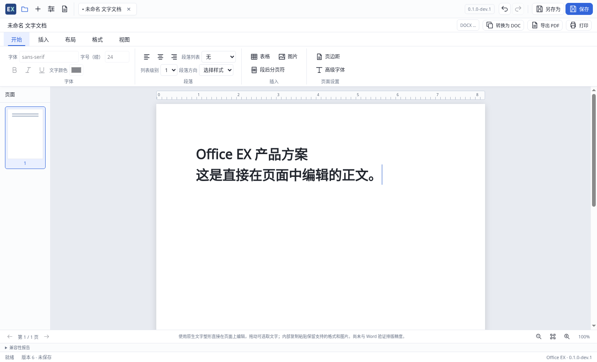
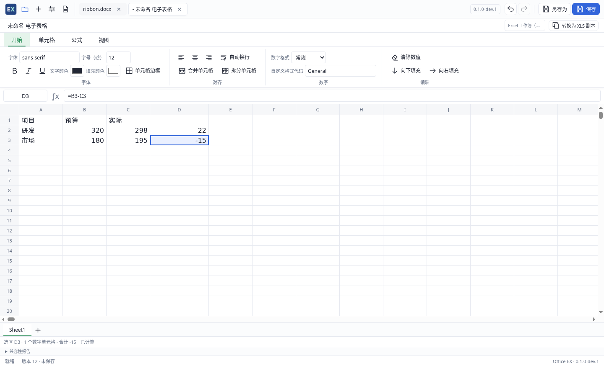

# Office EX desktop editor design system

The user approved the Microsoft Office-inspired layout direction. This implementation uses original SVG line icons and the existing document commands; it is not a copy of Microsoft's artwork. Screenshots below are actual local Linux desktop output, not concept images.

## Shared rules

- Compact document header: return to home, open, new, settings, about, undo/redo, save, document title, conversion and output actions.
- Two-level ribbon: selectable tabs, compact labeled groups, icons, consistent fields, tooltip/accessible names and keyboard tab navigation. Preserve the selected tab per editor; resize rather than expose all tabs at once.
- Document work area fills available space. Technical diagnostics are collapsible, not permanently occupying editing space.
- Controls call existing session commands, respect selection, format compatibility and protected-document policy. Do not advertise unsupported editing, cloud, collaboration or chart functionality.
- Light/dark theme, localized labels in the existing 22 locale catalogs (candidate translations, human review still required).

## Writer

Home: font, paragraph, styles and common shortcuts.
Insert: tables, table formatting, pictures, page/section breaks.
Layout: paper, section, margins, indentation and spacing.
Format: advanced typography, borders and numbering.
View: direct page editing and continuous/text editing alternatives.
Default view uses the native document page with thumbnail rail, ruler and zoom. Advanced text/table/image operations remain available. Thumbnails are lightweight derived projections, not exported previews.

## Sheets

Home: fonts, cell alignment, number formats and common editing.
Cells: row/column and worksheet commands.
Formulas: formula and calculation controls.
View: frozen panes, gridlines and RTL. Formula bar, address field, virtualized sheet, worksheet tabs and status remain available.

## Presentation

Home: slide management, font, text and common insertion.
Insert: shapes, images, text and connectors.
Design: slide and appearance controls.
Arrange: alignment, order and grouping.
View: zoom and contextual property controls.
Slide thumbnails, editing canvas and collapsible object/text/slide inspector remain live. Explicit text insertion/editing opens the text inspector; stage fit is based on the actual viewport.

## Verification boundaries

Local native editor-focused checks: 4/4; independent external document-focused native checks: 7/7. Core/tooling tests: 262/262. Independent presentation interoperability: 18 cases, including 15 editable and 3 protected. Updated obsolete negative spAutoFit fixture to test a rotated textbox outside the bounded editable profile. Full native smoke navigates actual ribbon/view tabs; no hidden controls are artificially exposed.

These changes do not establish exact Microsoft Office rendering, full format compatibility, human-reviewed translations or new-source macOS/Windows package verification. The public v0.1.0-dev.1 release and tag are unchanged.

Final full Linux native desktop regression: 34/34 passed on the redesigned UI, including alternate Writer mode navigation, image/table/list saves, crash recovery, and protected source preservation. See docs/verification/m5/ribbon/native-desktop.json.
